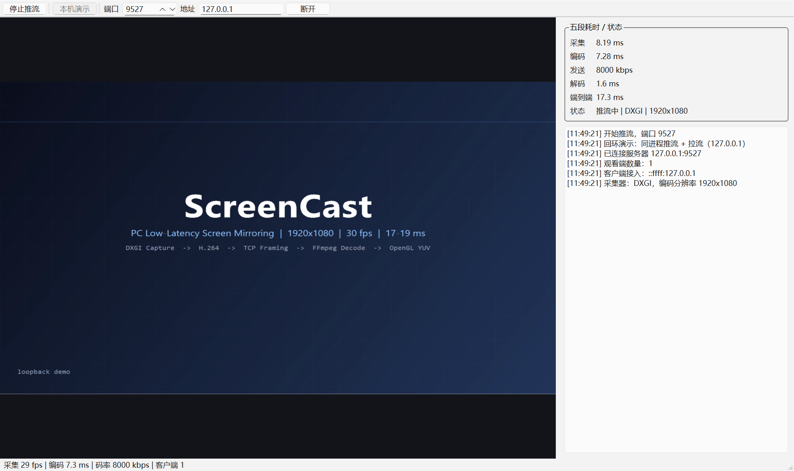

# ScreenCast

PC 端低延迟投屏系统（Windows / C++17 / Qt6 / FFmpeg / OpenGL）。

采集桌面 → 硬件无关的 H.264 软件编码 → 自定义 TCP 帧协议 → 解码 → OpenGL YUV 渲染，
支持本机回环与局域网两种模式，带五段耗时打点与自适应码率。

> 设计上参考了 scrcpy / QtScrcpy 的「采集端 + 播放端」分层思路，代码为独立实现：
> 采集端从 Android 换成了 PC（DXGI Desktop Duplication + GDI 兜底），传输协议、渲染管线、
> 码率控制与统计模块均为本项目自写。



## 快速体验

`dist/` 是本地打包目录（约 140 MB，不入库），用 `scripts/package.ps1` 生成。生成后双击或：

```powershell
.\dist\ScreenCast.exe --demo            # 自动开播 + 本机回环，直接看效果
.\dist\ScreenCast.exe --selftest 120    # 无界面跑采集->编码->解码，打印耗时
```

## 功能

- **采集**：DXGI Desktop Duplication（GPU 路径，桌面静止不重传）/ GDI BitBlt（兜底）
- **编码**：FFmpeg + libx264，`ultrafast` + `zerolatency`，无 B 帧、GOP 可配
- **传输**：TCP + 24 字节固定头 + 长度字段，接收端「读头 → 读体」状态机，天然处理粘包/半包
- **解码**：FFmpeg avcodec，多线程软解
- **渲染**：QOpenGLWidget + YUV420P 三纹理 + 片元着色器做 BT.709 色彩空间转换，GPU 完成 YUV→RGB
- **自适应码率**：按发送队列积压动态重建编码器（x264 不支持运行期改码率）
- **五段耗时**：采集 / 编码 / 发送 / 解码 / 端到端，界面实时显示
- **本机回环**：一个进程同时推流和拉流，方便演示

## 架构

```
┌────────────── GUI 线程 ──────────────┐      ┌──── worker 线程 ────┐
│ MainWindow                           │      │ CaptureWorker       │
│  ├─ VideoWidget (OpenGL 渲染)        │◄─────┤  ├─ ICapturer        │
│  ├─ StreamClient (拆包 + 解码)       │ 帧   │  │   ├─ DxgiCapturer │
│  ├─ StreamServer (广播 + 丢帧)       │◄─────┤  │   └─ GdiCapturer  │
│  └─ 统计面板 / 码率控制              │ 包   │  └─ VideoEncoder    │
└──────────────────────────────────────┘      └─────────────────────┘
                ▲ TCP
                ▼
         ┌──────────────┐
         │  观看端（可多开）│
         └──────────────┘
```

线程模型：

- **GUI 线程**：Qt 事件循环、TCP 收发、解码、OpenGL 渲染
- **worker 线程**：采集 + 编码，按 `1000/fps` 定时驱动，避免阻塞 UI

## 协议

固定 24 字节头 + 变长 payload，全部小端：

| 偏移 | 长度 | 字段 |
|---|---|---|
| 0 | 4 | magic `SCST` |
| 4 | 1 | version |
| 5 | 1 | type（1=配置 2=视频帧 3=Ping 4=Pong 5=Bye） |
| 6 | 1 | flags（bit0 关键帧） |
| 7 | 1 | reserved |
| 8 | 2 | width |
| 10 | 2 | height |
| 12 | 8 | pts（微秒，采集时刻） |
| 20 | 4 | payloadSize |
| 24 | N | H.264/H.265 码流 |

选择固定头而不是分隔符：接收端只需两次判断（凑齐头、凑齐体），没有转义和扫描开销。

## 构建

依赖：

- Visual Studio 2022（MSVC x64）
- Qt 6.8+（Widgets / Network / OpenGLWidgets）
- FFmpeg 4.4+ **shared** 开发包（含 `include/` 与 `lib/*.lib`）

```powershell
cmake -S . -B build -G "Visual Studio 17 2022" -A x64 `
      -DCMAKE_PREFIX_PATH="C:/Qt/6.8.3/msvc2022_64" `
      -DFFMPEG_ROOT="C:/ffmpeg"

cmake --build build --config Release
```

产物在 `build/Release/ScreenCast.exe`，Qt 与 FFmpeg 的运行库由 CMake 后置步骤自动拷贝。

也可以直接跑 `scripts/build.ps1`。

打包成可双击运行的 `dist/`（含 Qt / FFmpeg 运行库）：

```powershell
powershell -ExecutionPolicy Bypass -File scripts\package.ps1
```

## 运行

1. 启动程序，点「开始推流」，默认监听 `9527`
2. 同一台机器点「本机演示」；或另一台机器填服务器 IP 后点「连接」
3. 右侧面板看五段耗时、码率与客户端数量

## 性能（实测）

测试环境：AMD Radeon 610M 集显 / 2560×1600 桌面 / 编码输出 1920×1080 / 本机回环

| 指标 | 数值 |
|---|---|
| 采集（DXGI + 行拷贝） | 7~9 ms |
| 编码（x264 ultrafast / zerolatency） | 6~8 ms |
| 解码 | 1~2 ms |
| 端到端（采集开始 → 解码完成，不含 GPU 呈现） | 16~18 ms |
| 实际帧率 | 28~30 fps |
| 码率 | 8 Mbps |

无界面自检（`ScreenCast.exe --selftest 120`，720p 编码）：

```
[selftest] capturer=DXGI 2560x1600
[selftest] frames=120 packets=120 decoded=120
[selftest] avg encode=5.64 ms  avg decode=0.97 ms
[selftest] stream=873 kB  bitrate=4333 kbps  elapsed=1.6 s  fps=72.7
```

> 端到端在接收端统计，时间戳用采集开始时刻；只算到解码完成，不含 Qt 把帧画到屏幕的时间。
> 1080p 下采集 + 编码是串行瓶颈，稳定在 28~30 fps；降到 720p 可以跑满 60 fps。

## 两个容易忽略的坑

- **HiDPI 下的预览**：`QOpenGLWidget` 的 FBO 按设备像素分配，`glViewport` 必须用
  `width() * devicePixelRatio`。用逻辑像素会在 150% 缩放时只画左下角 2/3。
- **帧率节拍**：单帧采集 + 编码约 14 ms，固定 33 ms 定时器的实际周期会变成 47 ms（≈21 fps）。
  改成每帧结束后按已用时间补偿，才真正跑满 30 fps。

## 目录

```
src/
  app/        MainWindow
  capture/    ICapturer / DxgiCapturer / GdiCapturer
  codec/      VideoEncoder / VideoDecoder
  core/       Types / Config
  net/        Protocol / StreamServer / StreamClient
  pipeline/   CaptureWorker
  render/     VideoWidget
docs/         architecture.md
```

## 已知限制

- 仅 Windows（DXGI / GDI 依赖 Win32）
- 未合成鼠标指针（Desktop Duplication 的指针信息需要额外绘制）
- 音频未实现
- 控制回传（键鼠注入）未实现，当前是单向投屏

## License

[MIT](LICENSE)
